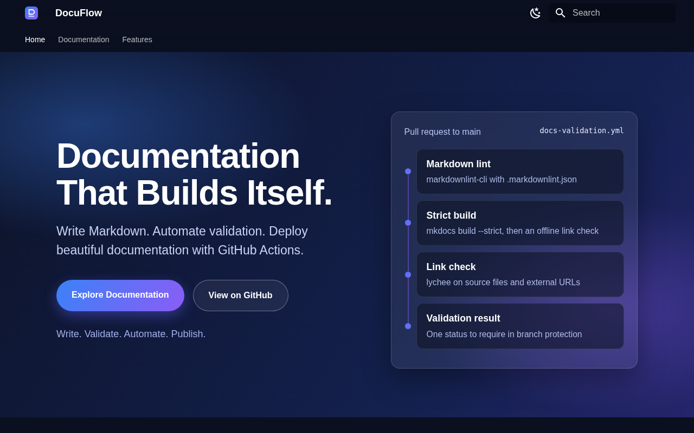
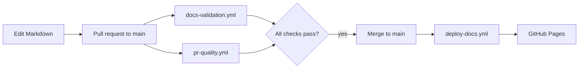
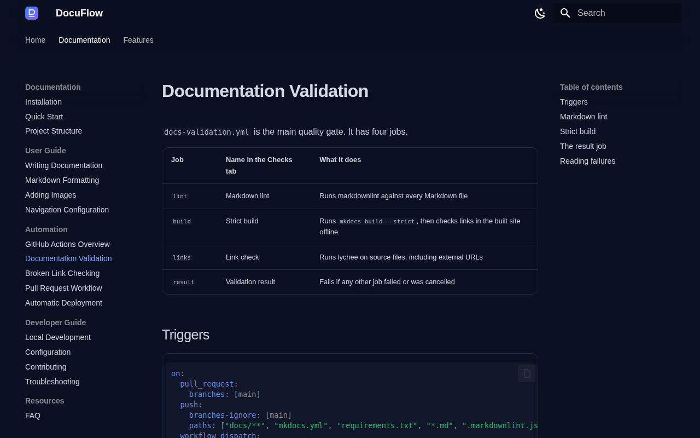
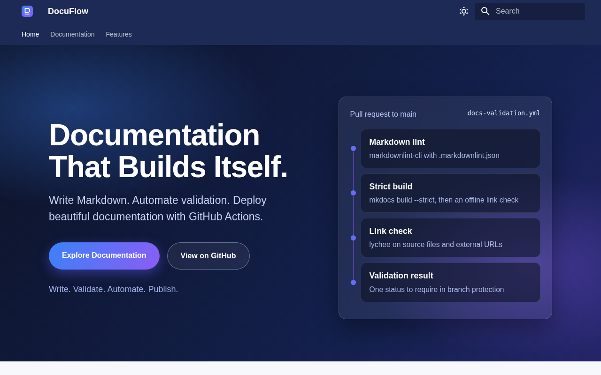

# DocuFlow

**Write. Validate. Automate. Publish.**


DocuFlow is an automated developer documentation portal. Write pages in Markdown, open a pull request, and
GitHub Actions lints the Markdown, builds the site in strict mode and checks every link. When a change reaches `main`,
the site is rebuilt and published to GitHub Pages. Everything runs on free services and needs no secrets.



## Features

- Premium dark and light theme with a custom landing page and interactive pipeline.
- Full-text search, table of contents, copy-code buttons, admonitions, content tabs and Mermaid diagrams.
- Markdown linting with markdownlint and a strict MkDocs build.
- Internal and external link checking with lychee, with retries for temporary network errors.
- Pull request quality checks: configuration validity, pinned actions, minimal permissions.
- Automatic publishing to GitHub Pages with the official actions.
- Issue forms and a pull request template with a validation checklist.

## Technology stack

| Area | Tools |
| --- | --- |
| Site | Python 3.12, MkDocs 1.6.1, Material for MkDocs 9.8.0 |
| Quality | markdownlint-cli 0.45.0, lychee 0.24.2 |
| Automation | GitHub Actions, GitHub Pages |
| Styling | Custom CSS and plain JavaScript |

## Architecture



## Installation

```bash
git clone <repository-url>
cd docuflow
```

macOS and Linux:

```bash
python3 -m venv .venv
source .venv/bin/activate
pip install -r requirements.txt
```

Windows PowerShell:

```powershell
python -m venv .venv
.venv\Scripts\Activate.ps1
pip install -r requirements.txt
```

## Local development

```bash
mkdocs serve
```

Open <http://127.0.0.1:8000/>. To build exactly as CI does:

```bash
mkdocs build --strict
```

Run every check locally:

```bash
python scripts/check_config.py
npx --yes markdownlint-cli@0.45.0 "**/*.md" ".github/**/*.md"
mkdocs build --strict
lychee --config lychee.toml --no-progress docs README.md CONTRIBUTING.md
```

## GitHub Actions workflows

| Workflow | Trigger | What it does |
| --- | --- | --- |
| `docs-validation.yml` | Pull requests to `main`; pushes to other branches | Markdown lint, strict build, link checks, one aggregated **Validation result** |
| `pr-quality.yml` | Pull requests to `main` | Validates configuration, pinned actions, permissions, and the PR checklist |
| `deploy-docs.yml` | Push to `main`; manual run | Builds the site and deploys it to GitHub Pages |

To require the checks before merging, add **Validation result** and **Configuration checks** to a branch protection rule
for `main`. Steps are in the documentation under Automation, Pull Request Workflow.

## Deployment

1. Create a repository on GitHub and push this project to it.
2. Open **Settings**, then **Pages**, and set **Source** to **GitHub Actions**.
3. Open **Actions**, choose **Deploy Documentation** and select **Run workflow**.
4. When the run succeeds, open the URL shown on the deploy job or the Pages settings page.
5. Merge a documentation change later and confirm a new run starts automatically.

The site and repository URLs are supplied to MkDocs through the `DOCS_SITE_URL` and `DOCS_REPO_URL` environment
variables, which the deploy workflow sets. Nothing is hardcoded.

## Folder structure

```text
docuflow/
├── .github/
│   ├── ISSUE_TEMPLATE/
│   ├── workflows/
│   └── pull_request_template.md
├── docs/
│   ├── assets/
│   ├── getting-started/
│   ├── user-guide/
│   ├── automation/
│   ├── developer-guide/
│   └── resources/
├── scripts/check_config.py
├── .markdownlint.json
├── lychee.toml
├── mkdocs.yml
└── requirements.txt
```

## Screenshots

Captured from a local build.




## Known limitations

- Mermaid diagrams and web fonts load from the internet in the browser.
- External link checks reflect the moment they ran; sites can change or block automated requests.
- Material for MkDocs announces end of life on May 5, 2027, with critical fixes continuing until then. Its maintainers
  point to Zensical as the successor.

## Contributing

See [CONTRIBUTING.md](CONTRIBUTING.md). Run the local checks above and complete the pull request template.

## License

Released under the [MIT License](LICENSE).
