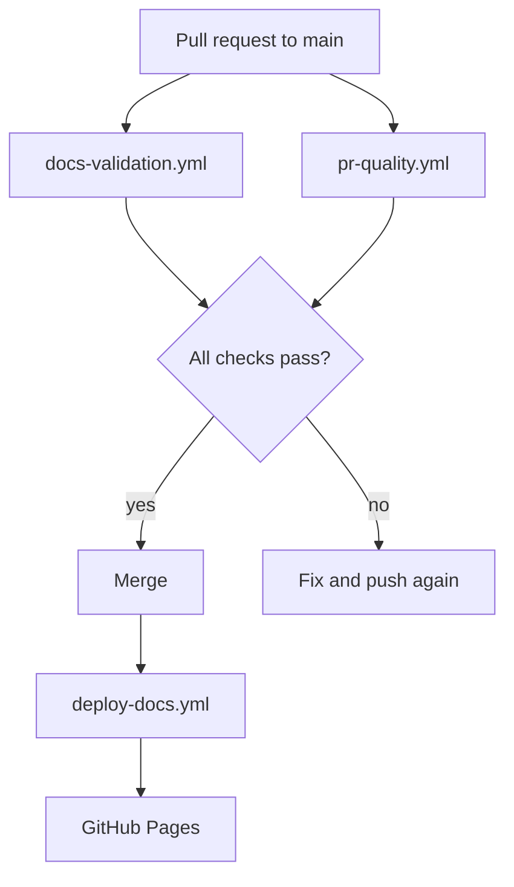

# GitHub Actions Overview

DocuFlow ships three workflows in `.github/workflows/`. Each has one job to do and asks for the smallest set of
permissions it needs.

| Workflow | File | Runs on | Purpose |
| --- | --- | --- | --- |
| Documentation Validation | `docs-validation.yml` | Pull requests to `main`; pushes to other branches | Lint, strict build, link check |
| Pull Request Quality | `pr-quality.yml` | Pull requests to `main` | Configuration and workflow security checks |
| Deploy Documentation | `deploy-docs.yml` | Pushes to `main`; manual run | Build and publish to GitHub Pages |

## How they fit together



The expensive checks (lint, build, links) live only in `docs-validation.yml`. `pr-quality.yml` is intentionally cheap
and never repeats them, so a pull request does not pay for the same work twice.

## Security practices used

- **Least privilege.** Each workflow declares `permissions:`. Validation uses `contents: read`. Only the deploy job
  receives `pages: write` and `id-token: write`.
- **Pinned actions.** Third-party and first-party actions are referenced by full commit SHA with the release tag in a
  comment. `scripts/check_config.py` fails the pull request if an unpinned action appears.
- **No secrets.** Nothing in the repository requires a personal access token or a stored secret.
- **No dangerous triggers.** `pull_request_target` is not used, so code from forks never runs with write access.
- **Untrusted input stays out of scripts.** Pull request text is passed through environment variables rather than
  inserted into shell commands.
- **Concurrency.** Validation cancels superseded runs. Deployment never runs two deployments at once.

## Reading a workflow file

```yaml
name: Documentation Validation   # shown in the Actions tab

on:                              # events that start the workflow
  pull_request:
    branches: [main]

permissions:                     # what GITHUB_TOKEN may do
  contents: read

jobs:
  lint:                          # a job runs on its own runner
    runs-on: ubuntu-latest
    steps:                       # steps run in order and share the checkout
      - uses: actions/checkout@<sha>
      - run: npx --yes markdownlint-cli@0.45.0 "**/*.md"
```

## Where to see results

Open the **Actions** tab to read logs, or the **Checks** tab of a pull request for a summary per job. Each validation
run also writes a short table to the run summary page.

Next: [Documentation Validation](documentation-validation.md).
