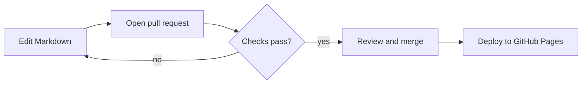

# Features

DocuFlow combines a documentation site built with MkDocs and Material for MkDocs with GitHub Actions workflows that
check every change. This page lists what is included and where to read more.

## Reading experience

| Feature | How it is provided |
| --- | --- |
| Full-text search | Material for MkDocs `search` plugin with suggestions, highlighting and shareable queries |
| Dark and light themes | Palette toggle in the header; the default follows the operating system setting |
| Table of contents | Generated from headings on every page and kept in view while scrolling |
| Syntax highlighting | Pygments through `pymdownx.highlight` |
| Copy-code buttons | The `content.code.copy` theme feature |
| Previous and next links | The `navigation.footer` theme feature |
| Callouts | Admonitions such as note, warning and tip |
| Diagrams | Mermaid fenced blocks, rendered in the browser |
| Mobile layout | Responsive layout with a drawer navigation on small screens |

??? example "See the copy button and highlighting"

    ```python
    def greet(name: str) -> str:
        """Return a friendly greeting."""
        return f"Hello, {name}!"
    ```

## Automation

| Capability | Where it lives | Details |
| --- | --- | --- |
| Markdown linting | `docs-validation.yml` | [Documentation validation](automation/documentation-validation.md) |
| Link checking | `docs-validation.yml` | [Broken link checking](automation/broken-link-checking.md) |
| Strict builds | `docs-validation.yml` | Warnings become errors |
| Configuration checks | `pr-quality.yml` | [Pull request workflow](automation/pull-request-workflow.md) |
| Deployment | `deploy-docs.yml` | [Automatic deployment](automation/automatic-deployment.md) |

## Diagram example



## Design decisions

- No database, backend or paid service is needed. The output is static HTML.
- No repository secrets are used. Workflows rely on the built-in `GITHUB_TOKEN` with minimal permissions.
- Every tool version is pinned, so a build today behaves like a build next month.
