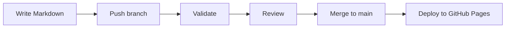

# Introduction

DocuFlow is a documentation portal and a set of GitHub Actions workflows that keep it healthy. You write pages in
Markdown, open a pull request, and automated checks tell you whether the change is safe to merge. When a change lands
on `main`, the site is rebuilt and published to GitHub Pages.

The repository you are reading is both the product and its own demonstration: this website is the output of the
workflows it documents.

## The problem it solves

Documentation usually fails quietly. Links rot, headings drift into inconsistent styles, and a page that renders on one
laptop breaks the real build. DocuFlow turns those problems into failed checks that block a merge instead of
surprises that readers find later.

## How it works

1. You edit Markdown files under `docs/`.
2. A pull request starts the validation workflows: linting, a strict build and a link check.
3. Reviewers see the results next to the diff.
4. Merging to `main` starts the deployment workflow, which publishes the built site.

## What you need to know

- Basic Git: clone, branch, commit, push.
- Basic Markdown. The [Markdown formatting guide](../user-guide/markdown-formatting.md) covers everything used here.
- No YAML or GitHub Actions experience is required to write pages. It helps if you want to change the automation.

## Technology

| Component | Purpose |
| --- | --- |
| Python 3.12 | Runs MkDocs |
| MkDocs and Material for MkDocs | Builds the static site and provides the theme |
| markdownlint-cli | Checks Markdown style |
| lychee | Checks links |
| GitHub Actions | Runs the checks and the deployment |
| GitHub Pages | Hosts the published site for free |

Continue with [Installation](installation.md).
