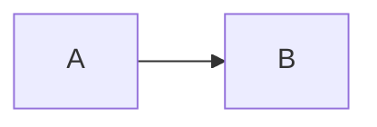

# Markdown Formatting

DocuFlow uses standard Markdown plus several extensions enabled in `mkdocs.yml`. The lint configuration keeps the
source consistent.

## Headings and emphasis

Use `#` style headings, `*italic*` for emphasis and `**bold**` for strong emphasis. The linter rejects underline-style
headings and mixed emphasis markers.

## Lists

Use a dash for bullets and indent nested lists by four spaces, which Python-Markdown requires:

```markdown
- First item
    - Nested item
- Second item

1. Step one
2. Step two
```

## Code blocks

Always declare the language so highlighting works and the linter passes:

````markdown
```python
print("Hello, DocuFlow")
```
````

Use `text` for output or directory trees. Add a title or line numbers with attributes:

````markdown
```python title="hello.py" linenums="1"
print("Hello, DocuFlow")
```
````

## Admonitions

```markdown
!!! note "Optional title"

    Indent the body by four spaces.

??? tip "Collapsed by default"

    Use `???` for content readers can expand.
```

Available types include `note`, `tip`, `warning`, `danger`, `example`, `info` and `success`.

!!! info "Example"

    This is how a rendered `info` admonition looks.

## Content tabs

````markdown
=== "macOS and Linux"

    ```bash
    source .venv/bin/activate
    ```

=== "Windows PowerShell"

    ```powershell
    .venv\Scripts\Activate.ps1
    ```
````

## Tables

```markdown
| Name | Purpose |
| --- | --- |
| `mkdocs.yml` | Site configuration |
```

## Mermaid diagrams

````markdown

````

## Keyboard keys and highlights

Write ++ctrl+c++ to render a key cap and `==marked text==` to highlight a phrase.

## Line length

Wrap prose at 120 characters. Code blocks and tables are exempt. Long URLs may exceed the limit when they cannot be
broken.
